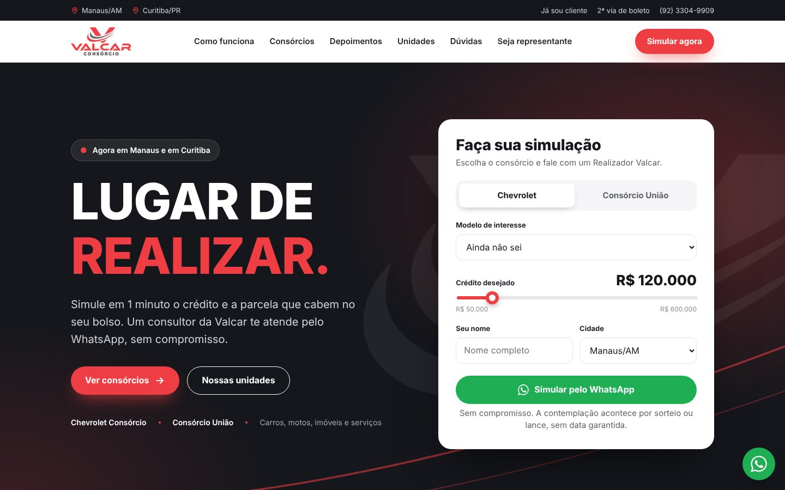

# Valcar Consórcio — Lugar de realizar

Site da Valcar Consórcio, com unidades em **Manaus/AM** e **Curitiba/PR** (dentro da Chevrolet Metrosul), Chevrolet Consórcio e Consórcio União.

🔗 **Site:** [consorciovalcar.com.br](https://consorciovalcar.com.br/)



## O que tem no site

- Simulador que envia a simulação pronta para o WhatsApp (Chevrolet por modelo ou Consórcio União: carro, moto, imóvel e serviços)
- Carrossel deslizante com os 13 modelos Chevrolet
- Números da Valcar, como funciona e diferenciais
- Seção do Consórcio União
- Depoimento em vídeo e avaliações de clientes reais
- Unidades de Manaus e Curitiba com mapa e "Como chegar"
- Campanha Pontualidade Premiada, dúvidas frequentes
- Página **Seja Representante** com ficha enviada pelo WhatsApp e link para **Trabalhe Conosco**

## Tecnologias

HTML5, CSS3 e JavaScript puro. Sem build: é só abrir o `index.html`. Publicado no GitHub Pages com domínio próprio (`CNAME`).

## Estrutura

```
index.html            página principal
representante.html    Seja Representante
assets/css/           estilos
assets/js/            simulador, carrossel e menu
assets/img/           logos, modelos e fotos
assets/depoimentos-valcar.mp4
```

Desenvolvido por [Clear Code](https://eduruppluz.github.io/clear-code-site/).
